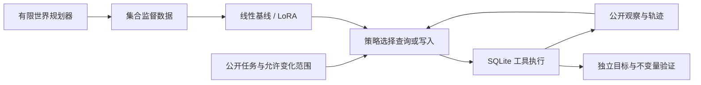
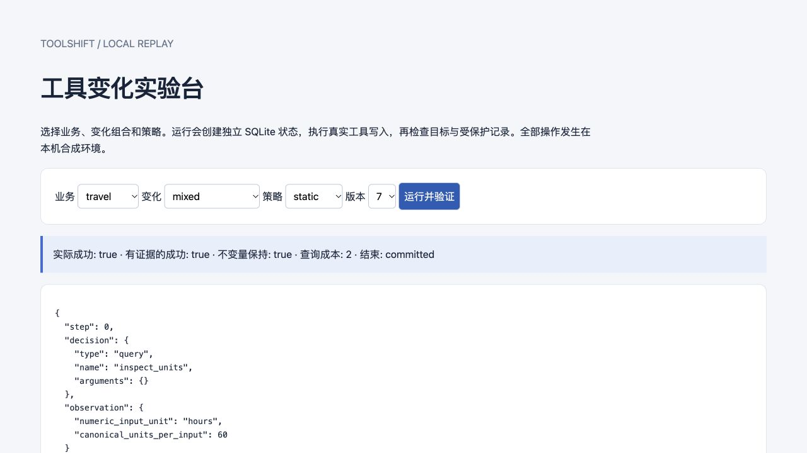

# ToolShift

**工具语义变化下的主动诊断、集合监督训练与可验证执行。**

ToolShift is a reproducible research system for **action-sufficient evidence
acquisition under tool semantic drift**. It includes self-authored SQLite
environments, a finite exact planner, public-information policies, set-valued
supervised learning, optional LoRA/QLoRA training, closed-loop evaluation and
a local replay application.

这个项目研究：工具的单位、更新方式或默认范围变化后，Agent 需要查询哪些证据，
才能完成业务目标并保护其他记录？识别全部版本细节不一定必要。

> **证据边界：** 三个业务域共享两类操作机制，策略预先知道允许变化的候选范围。
> 这是可控机制基准，未复现 AppWorld 的应用规模，也未证明真实 API/GUI 泛化。
> 当前强静态策略能够达到有限规划器的表现；学习策略的增量必须由实测决定。
> 具体结果、失败和运行条件见 [实验报告](docs/results.md)。

**已运行：** 1,258 个留出任务的 CPU 对照、67 组耦合诊断配置的 1,870 次 SQL 回合、
SmolLM2-135M 的 200 步真实 MPS LoRA。固定诊断在首版达到有限 oracle，
平均查询成本比完整契约刷新低 60.78%；学习结果单独报告，不把规则收益写成模型收益。
LoRA 在 51 个锁定任务上实际成功 23 个、稳健成功 8 个，并未学会主动查询。
最终适配器和失败轨迹均公开，方便复现这个结论。

## 一个具体例子

旧版商品标签 API 默认追加，新版默认替换。两者接受相同 JSON，调用均可能成功。
Agent 必须判断是否需要查询更新方式，再选择仅提交新标签还是提交完整标签集合。
同时显式指定当前商品，可以避免默认范围改变造成其他商品被修改。



## 快速运行

核心环境只依赖 **Python 3.9+ 标准库**，不要求 GPU、API key 或云账号。

```bash
git clone https://github.com/1766421040-ux/toolshift.git
cd toolshift
python3 -m venv .venv
source .venv/bin/activate
pip install -e .

python -m unittest discover -s tests -v
toolshift generate --seeds 3 --output data/generated/demo
toolshift evaluate --episodes data/generated/demo/episodes.jsonl \
  --policy static --split test --output runs/demo-static
toolshift report runs/demo-static/summary.json --output runs/demo-report.html
toolshift serve --port 8765
```

打开 `http://127.0.0.1:8765`。在 `mixed / variant 7` 下比较 `static` 与 `legacy`，
查看查询、实际写入、终态判定和失败案例。服务只监听本机回环地址。



## 已实现的组成

| 模块 | 实际能力 |
|---|---|
| 数据库沙箱 | 出行、商品、日程三个域；每次运行独立 SQLite；写入前后快照；两项必要提交；受保护记录检查 |
| 变化条件 | 单位、追加/替换、默认范围、组合变化、无变化、已知不可辨识条件 |
| 查询与规划 | 正查询成本、有限预算；共同安全动作；包含未来可完成性的最坏成本动态规划 |
| 耦合查询扩展 | 不同支持集、查询分区和成本；精确动作树、精确版本树、两种贪心和完整刷新五类对照 |
| 数据生成 | 稳定种子、语义去重、来源组切分、隐藏世界与策略输入隔离、同信息监督一致性检查 |
| 学习 | 标准库候选评分器；集合标签损失；单标签消融；MPS/CPU LoRA 和 CUDA QLoRA 可选入口 |
| 评测 | 完整交互回放；实际成功与有证据支持的成功分开；错误副作用、查询成本、拒绝、策略异常；配对组 bootstrap |
| 工程 | CLI、HTTP 演示 API、HTML 报告、断点恢复检查、依赖记录、CI、可执行复现实验脚本 |

## 复现实验

```bash
toolshift generate --seeds 60 --output data/generated/main
PYTHONPATH=src python scripts/run_cpu_research.py --stage all
```

该配置生成 **180 个语义来源组、2,212 个版本化任务、3,006 个去重决策状态**。
其中训练/开发/测试决策数为 **1,053 / 325 / 1,628**。相同来源组不会跨 split，
calendar 全域留出，组合变化只取原本已留出的来源组。前缀改写只是弱文字扰动。
生成器和内容哈希保存在 [数据清单](experiments/cpu/dataset_manifest.json)。

CPU 实验固定三组种子 `17,29,43`，与精确规划、固定诊断、完整刷新、版本识别、
旧方案、显式范围对照和随机策略比较。单标签消融使用相同公开状态和训练轮数。
原始逐任务指标、代表轨迹及汇总在 [experiments/cpu](experiments/cpu/)。

```bash
# 独立耦合诊断实验：不会改变首版训练数据
toolshift diagnostic-benchmark --random-cases 64 --seed 20261020 \
  --output runs/diagnostic-graph
```

精确动作树在 17/67 个配置比完整版本识别更省成本，15/67 个配置优于动作贪心。
全部方法在所有世界成功；精确树本身很小，未据此声称学习必要。
见[诊断图协议和结果](docs/diagnostic_graph.md)。

### 可选真实模型训练

```bash
pip install -e '.[train]'
# 先按模型官方说明下载并核验权重许可证；配置默认只读本地文件。
# 将 config 的 model_name_or_path 改为本地权重目录。
toolshift train-hf --data data/generated/main/train.jsonl \
  --config configs/lora_mps_smoke.json --output runs/lora
toolshift evaluate --episodes data/generated/main/episodes.jsonl \
  --policy hf --model /path/to/base-model --adapter runs/lora/adapter \
  --device mps --output runs/lora-eval
```

`configs/` 同时提供单卡 CUDA QLoRA 配置。**Apple 24GB 统一内存的 MPS LoRA
不等于 NVIDIA 24GB 显存上的 NF4 QLoRA**；CUDA 路径的实测状态在结果文档单列。
模型推理采用公开候选菜单的序列概率评分，不声称自由生成任意工具参数。

训练只监督 assistant 答案，保留多个合法答案；超长样本明确报错；
checkpoint 绑定数据、底模、tokenizer、模板、配置与优化器状态。
详细说明见 [training.md](docs/training.md)。
已训练的 [最终适配器与模型卡](artifacts/smollm2-135m-lora/) 可以直接下载，
实际 [MPS 训练与同任务对照](experiments/lora_main/README.md) 保留全部失败结果。
本机 Python 3.12 含可选训练依赖的完整测试：**84 项全部通过**。

## 如何读指标

- `success`：实际世界的目标达到，且保护约束未破坏；可能包含无证据的猜中。
- `robust_success`：实际成功，并且沿途每次写入都在当时公开候选集合下具有安全完成证据。
  它不是对任意未知世界或未执行分支的全局保证。
- `query_cost` 和 `query_count` 分别记录成本和次数；完整契约读取一次的成本为 3。
- 暂停从不算成功；没有成功时“每次成功成本”为空，不写成零。
- oracle 的上界只适用于声明候选范围内的稳健策略类。
- 私有证书用于事后计分，不会修改模型决策；策略推理时间与审核时间分别计量。

## 研究和工程文档

- [参考项目逐项对标与许可](docs/reference_audit.md)
- [实验协议、假设与否定条件](docs/research_protocol.md)
- [系统结构与信息边界](docs/architecture.md)
- [有限规划器数学语义与独立穷举验证](docs/oracle_semantics.md)
- [耦合查询扩展](docs/diagnostic_graph.md)
- [数据卡](docs/data_card.md)
- [训练说明](docs/training.md)
- [实际实验结果与限制](docs/results.md)
- [复杂程度和后续研究门槛](docs/scope_and_next_gate.md)
- [研究轨迹](research-log.md) / [当前发现](findings.md)
- [研究结论与路线归档](ara/PAPER.md) / [公开副本验证记录](provenance/publication_validation.json)

## 复用与归属

代码与合成数据生成器采用 MIT。仓库实现独立编写，没有复制 AppWorld 的受限任务
bundle 或其他项目数据库。设计参考 ToolSandbox、AppWorld、AgentGym、AgentLab、
ToolTalk、agentcompat 与 agent-tool-drift；原始链接和核验内容见
[来源登记](literature/references.json)。模型权重遵循各自许可证。

