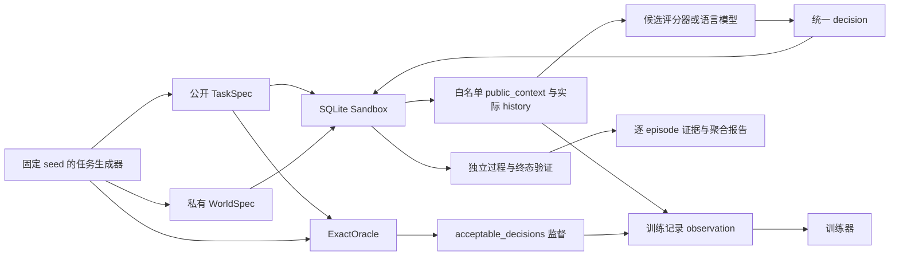

# ToolShift 架构与接口

本项目把工具升级后的信息获取、执行和判分分开。核心是独立编写的 SQLite 沙箱与有限世界 oracle；CPU 候选评分器和可选语言模型使用相同公开接口。下述接口是组件约定，命令行入口以 `python -m toolshift --help` 和实际 CLI 文档为准。

## 1. 数据流与信任边界



真实 WorldSpec 和 oracle 的输出不能通过 observation、候选描述、文件名、任务 ID 或无意序列化进入策略。主实验另外公开 `uncertainty_contract`：描述可能变化的允许范围，或去 ID 的候选语义支持集；它不表明真实世界，且所有方法获得相同内容。`acceptable_decisions` 只作为训练标签，不能被拼入提示或特征。

这里首先是数据与 API 的逻辑隔离，并不等于对任意恶意 Python 代码的操作系统级隔离。内置策略只接收 JSON 值，不能接收 Sandbox、数据库连接或 ExactOracle 实例。未来接任意外部 agent 时，应通过独立进程/API 限定权限，不能把当前白名单检查宣传为完整安全沙箱。

## 2. 核心组件

| 模块 | 责任 | 不能承担的责任 |
|---|---|---|
| `schema` | `TaskSpec`、`WorldSpec`、`Action(tool,args)`、`Query(name,args)` 与序列化 | 不自动把所有 dataclass 字段公开 |
| `domains` | 域规则、工具声明、独立任务生成与候选生成 | 不根据真实 WorldSpec 过滤公开候选 |
| `sandbox` | SQLite 初始化、只读查询、真实写入、写锁、轨迹与验证 | 不因当前动作碰巧正确就向策略发送正确标签 |
| `oracle` | 有限 belief 的历史一致性、未来可完成性、最坏成本 DP | 不直接替可部署模型选动作或泄漏隐藏世界 |
| `protocol` | 把可能支持集转换成公开 uncertainty_contract，统一策略输入 | 不使用实际 world 决定公开范围 |
| `model_policy` | 公开输入检查、候选规范化、CPU 评分及 HF 推断 | 不接收训练标签作为输入 |
| `training` | 集合监督、模型/优化状态保存、恢复与训练审计 | 不把训练集命中率当任务完成率 |
| 数据生成/评估/CLI 层 | 来源族切分、轨迹生成、策略运行、成本与结果统计 | 不静默删除系统异常、失败或暂停 |

核心 API：

```text
Sandbox(task: TaskSpec, world: WorldSpec)
  public_context() -> JSON
  query(Query) -> StepResult(observation, done, error)
  act(Action) -> StepResult(observation, done, error)
  verify() -> evaluator result
  close()

ExactOracle(task: TaskSpec, worlds: sequence[WorldSpec], max_actions=4)
  decide(history, query_budget)
    -> {kind, actions, queries, worst_cost, reason}
```

`verify()` 结果属于评估数据，不能直接成为下一轮策略输入。`StepResult.observation` 只含真实工具返回，不含成功真值。`ExactOracle.decide` 只用于训练标签、上界和诊断；普通策略必须从公开历史和共同提供的 uncertainty_contract 推断。默认标签采用 act-first 次级 tie-break，不能与“完整最优集合”混称。评估器在动作执行时另外检查其是否属于当前 `safe_actions`，记录 robust_success 与实际 success 的区别；不会把该私有检查用于策略纠错。

## 3. 三域 SQLite 任务

| 域 | 业务表 | 数值写步骤 | 集合写步骤 |
|---|---|---|---|
| travel | `travel_records` | `set_duration` | `update_stops` |
| catalog | `catalog_records` | `set_price` | `update_tags` |
| calendar | `calendar_records` | `set_length` | `update_attendees` |

每个域至少有两个必要写步骤，以及不应被修改的非目标记录。`effect_log` 用于执行证据。数值可能采用不同单位；集合可能采用 append/replace；默认范围可能变化。每个写字段第一次提交即锁定，此规则在公开契约中声明。错误提交不能通过再次覆写或重置恢复成成功。

独立验证包含：

1. 非目标记录不变，原有必须保留的集合项未被删除。
2. 目标记录最终数值、集合和完成状态满足任务。
3. 写锁与操作前提符合规则，无额外效果。

错误数值可能不立即破坏非目标记录，却因字段锁定而使后续目标不可达。这是测试“当前不变量检查”与“未来可完成性”的关键反例，不能只统计异常或回滚所有错误来消除它。

## 4. 查询与预算

初版查询名为 `inspect_units`、`inspect_update_mode`、`inspect_default_scope`、`read_state`，成本各 1；完整 `read_contract` 成本 3。具体返回由任务与隐藏世界决定，但只在调用后公开。所有查询必须保持业务状态不变；审计日志本身可追加，不属于业务副作用。

`scope=current` 是公开可用的显式参数，能在不同默认范围世界中给出共同正确动作，因此不必为每次操作识别默认 scope。不可辨识世界对全部可用语义查询给出相同的不可用信息；策略必须依靠已有共同动作，或安全暂停，不能猜版本。

预算按实际调用扣减；重复、无信息和被拒绝的查询是否收费须在运行配置中统一声明，不能对不同策略采用不同规则。模型推理 token 和沙箱查询成本是两笔不同账，均须单独记录。

## 5. 公开 JSON 合约

`Sandbox.public_context()`：

```json
{
  "task_id": "opaque task identifier",
  "domain": "catalog",
  "instruction": "公开任务目标",
  "legacy_docs": "旧契约及写锁说明",
  "initial_state": {},
  "tools": [],
  "queries": [],
  "candidates": [],
  "query_budget": 3
}
```

这个例子说明核心字段，不是可执行数据样本。集成层会添加公开 `uncertainty_contract`，具体嵌套位置以 `protocol` 实现为准。`initial_state` 是首版明确允许策略查看的业务初态，不包括真实版本参数。`task_id` 不能编码 split、world、正确动作或变更类型；真实世界改变时它保持一致。domain 可公开，但不能把 template/suite/组合标签偷偷作为提示捷径。

传给策略的统一 observation：

```json
{
  "context": {},
  "history": [
    {
      "kind": "query",
      "call": {"name": "read_state", "args": {}},
      "observation": {}
    }
  ],
  "candidates": [
    {"type": "query", "name": "read_contract", "arguments": {}},
    {"type": "stop", "name": "stop", "arguments": {}, "status": "insufficient_evidence"}
  ],
  "remaining_budget": 3
}
```

历史动作使用 `call: {"tool": "...", "args": {...}}`，查询使用 `call: {"name": "...", "args": {...}}`。策略的返回统一为：

```text
{type: "query" | "act" | "stop", name: string, arguments: object, status?: string}
```

runner 明确转换为核心的 Action/Query；不靠字符串猜测工具类型。候选重复通过规范 JSON 去重。无效决策、超预算和无法解析的输出成为可见失败类型，不自动用 oracle 修复后再报告模型成功。

核心 stop 的紧凑写法也可能为 `{"type":"stop","status":"pause"}`；模型层规范化为统一表示。不要要求原始数据中不存在的 name/arguments 字段。公开可能范围是本项目的额外假设；若不给它，按私有 suite 求的 oracle 标签可能与策略信息不匹配。

## 6. 训练与部署路径

CPU 路径：

```text
train_linear(records, output_dir,
             config={seed, epochs, dimensions, learning_rate},
             resume_from=None) -> summary
LinearPolicy.load(model.json).choose(observation, candidates=None) -> decision
```

这是哈希特征的线性候选评分器。它用真实优化训练检查监督和策略执行链路，不能称为大语言模型。

语言模型路径复用同一个 observation 和 decision 格式。HF 策略为候选决策计算序列概率；训练只监督最后 assistant 决策，公开上下文和工具观测不计算目标 loss。多个合法答案使用概率质量和目标，参数与长序列处理以 [training.md](training.md) 的实际实现为准。

本机为 Apple M4 Pro、24GB 统一内存，MPS 普通 LoRA 与 NVIDIA CUDA 的 24GB/NF4 QLoRA 是两条不同路径。能运行 MPS 不代表 bitsandbytes QLoRA 通过；同样，CPU 单测通过不能代表任何 LLM 已微调。结果中必须写明模型、设备、精度、量化状态及训练是否完成。

## 7. 可复现与故障处理

每个实验保存：配置与内容哈希、代码 revision、依赖版本、数据与 split manifest、随机 seed、训练状态、逐 episode 决策/观测、数据库验证结果和资源统计。

每个 episode 使用独立数据库；方法间同初态重建，方法内部禁止因错误而偷偷重置。断点恢复检查模型与数据指纹；不兼容则失败并说明原因。报告同时保留 `task_failure`、`safe_stop`、`budget_exhausted`、`format_error`、`engine_error` 等类别。

首版不依赖外部 API、VM、浏览器或真实账号。未来接 GUI 或真实工具时，须重新定义观察噪声、时间变化、权限与不可逆效果，当前有限世界证明不能直接沿用。
