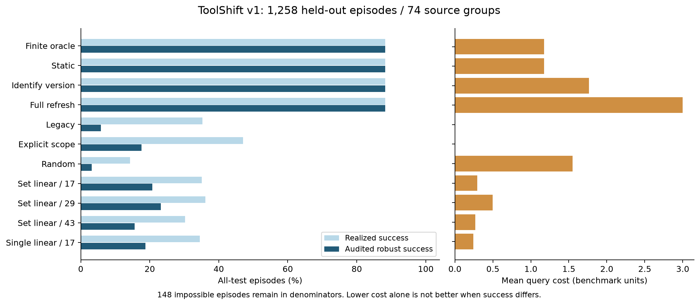
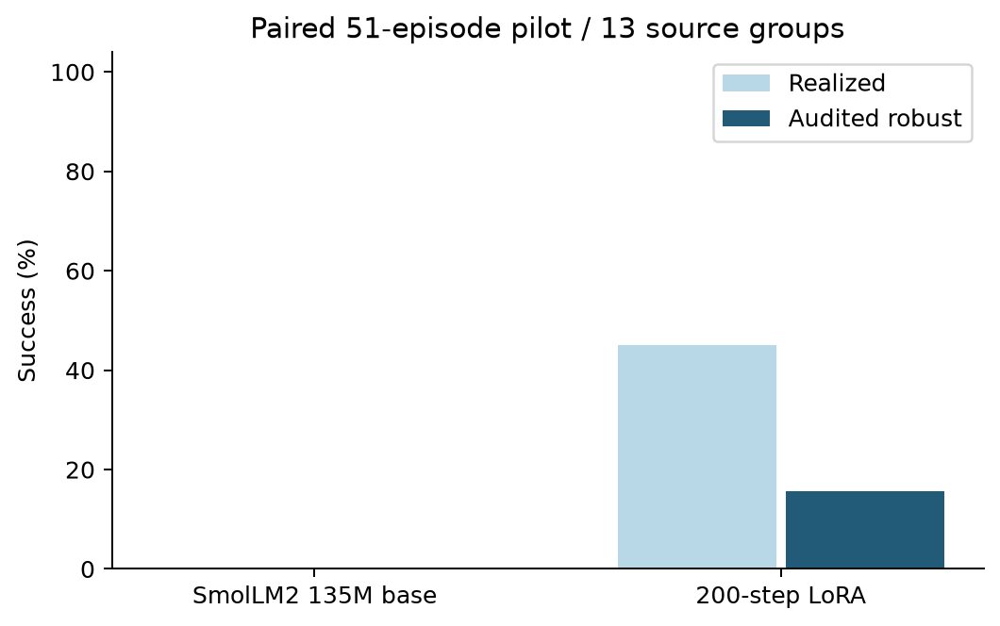

# 实验结果与证据边界

2026-10-20，ToolShift v0.1。所有下列数字来自仓库中的实际运行文件。
项目的已验证贡献是可复现的研究工程系统与条件内机制对照；没有建立全球首创、
真实 API 泛化或学习优于强规则的结论。

## 1. 数据和评测条件

自产合成数据包含 180 个语义来源组、2,212 个版本化任务和 3,006 个去重决策状态。
训练/开发/测试决策为 1,053/325/1,628；CPU 闭环评测覆盖全部 **1,258 个测试
episode、74 个来源组**。同源版本、预算和指令前缀不会跨 split。
calendar 全域留出，但三个域共用两类操作算子；不是未见工具机制外推。

初始业务状态、候选语义支持集和候选菜单均公开，只有真实世界身份隐藏。
每个任务必须完成数值字段和集合字段两次写入，同时保护其他记录。
SQLite 真的执行写入；评估器独立检查终态、过程不变量及写入证据。
暂停不算成功。148 个不可稳健完成的任务仍保留在全部任务的分母中。

文件：[数据清单](../experiments/cpu/dataset_manifest.json)、
[运行协议](../experiments/cpu/protocol.json)、
[判分的数学含义](oracle_semantics.md)。

## 2. 全量 CPU 闭环结果

| 策略 | 稳健成功 % | 实际成功 % | 平均查询成本 | 不变量违例 % |
|---|---:|---:|---:|---:|
| finite oracle（有限模型上界） | 88.24 | 88.24 | 1.1765 | 0 |
| static（任务相关规则） | 88.24 | 88.24 | 1.1765 | 0 |
| identify（识别版本） | 88.24 | 88.24 | 1.7647 | 0 |
| refresh（完整契约） | 88.24 | 88.24 | 3.0000 | 0 |
| legacy（沿用旧语义） | 5.88 | 35.29 | 0 | 47.06 |
| schema（旧语义 + 显式范围） | 17.65 | 47.06 | 0 | 29.41 |
| random / seed 17 | 3.18 | 14.31 | 1.5493 | 46.18 |
| linear set / seed 17 | 20.75 | 35.06 | 0.2957 | 28.22 |
| linear set / seed 29 | 23.21 | 36.17 | 0.4968 | 27.90 |
| linear set / seed 43 | 15.66 | 30.21 | 0.2671 | 36.57 |
| linear single / seed 17 | 18.76 | 34.50 | 0.2417 | 28.46 |

static 与 oracle 在 1,110 个可稳健完成任务上的成功率均为 100%，对 148 个
不可辨识任务暂停。相同成功水平下，static 平均查询成本比 refresh 低 **60.78%**，
比 identify 低 **33.33%**。成本是预先定义的基准单位：完整读取一次成本 3，
字段查询一次成本 1；这不是 API 调用次数、现金开销或部署延迟下降 60.78%。
static 平均查询次数 1.1765，refresh 为 1，不能声称调用次数更少。

三次集合线性训练的平均稳健成功率仅 19.87%，明显落后强静态策略。
seed 17 的集合监督比单标签高 1.99 个百分点，但这是一个配对种子的观察，
不能推出稳定的监督优势。三次集合训练在组合留出分类均为 0 稳健成功，
应作为迁移失败保留，不能只展示成功演示。

逐任务指标、每域/每 suite/域×suite 分解、代表轨迹均在
[experiments/cpu](../experiments/cpu/)。[配对区间](../experiments/cpu/paired_comparisons_to_oracle.json)
按来源组 bootstrap 2,000 次。规则对照的区间退化为一点是因为每个来源组具有
相同语义版本结构和成本差，不表示现实中不存在不确定性；合成样本组也不代表
真实业务分布。

## 3. 更复杂的耦合查询实验

针对首版被固定规则完全解决的问题，另建独立实验，不改动已锁定的训练数据。
64 个随机支持/分区/成本案例与 3 个固定成本例，共 **67 个案例、374 个世界**，
5 个策略全部遍历，共 **1,870 个实际数据库回合**。65 个不同的带标签支持/分区
结构未做图同构去重，不能称为 65 个独立图族。

| 方法 | 所有世界稳健成功 | 案例最坏成本的均值 |
|---|---:|---:|
| exact_action（共同正确计划） | 100% | 3.7015 |
| exact_version（完整语义识别） | 100% | 4.1343 |
| greedy_action | 100% | 3.9552 |
| greedy_version | 100% | 4.6418 |
| full_refresh | 100% | 5.8806 |

exact_action 相比 exact_version 在 17/67 个案例成本更低，其余持平；相比
greedy_action 在 15/67 个案例更低，其余持平。所有回合不变量违例为 0。
另外穷举审核了 1,396 个计划—世界对、两个写入顺序，共 2,792 次执行，
包含 1,022 个错误计划对，验证解析计划判断与 SQL 结果一致。

这说明在已知有限转移模型下，动作充分性目标和多步成本规划具有可区分的作用。
它没有证明学习必要：公开精确决策树最多 15 个节点，全部案例编译总耗时约
0.034 秒（单次本机计时）。此实验未训练任何模型，不能把其结果写入首版 LoRA 的成绩。
所有方法享有相同的公开支持集、查询分区和成本。

[锁定协议、复现和限制](diagnostic_graph.md)；
[原始结果](../experiments/diagnostic_graph/summary.json)。

## 4. 真实 LoRA 训练

底模为官方 SmolLM2-135M-Instruct，Apache-2.0；本机 Apple M4 Pro、24GB
统一内存，使用 MPS、fp32、all-linear LoRA rank 8、2,442,240 个可训练参数。
固定 seed 17、学习率 2e-4、梯度累积 2、最大长度 2,048。

完成 200 个优化步、400 次原始决策曝光（0.3799 epoch），耗时 554.40 秒。
这是工程链路与小模型能力的有限试验，不能称完整多轮大模型训练。
训练平均 loss 2.6375 不是测试成绩。

首次尝试在第 37 步 MPS 内存不足。修复为只对 assistant 预测位置计算词表 logits，
保留完整上下文注意力，并在优化步后释放未用缓存；与原实现的 loss 和参数更新
做过数值一致性检查。未关闭系统内存保护，未省略失败记录。
[失败记录](../experiments/lora_main/attempt_1_failure.json)和
[预注册配置](../experiments/lora_main/protocol_config.json)一并保留。

模型闭环评测使用事先锁定的同一批 51 个 episode、13 个来源组，按域×suite
选择来源组并保留组内所有世界。推理只按公开候选答案的序列概率选动作；
没有 oracle 自动纠错。实际结果如下：

| 模型 | 实际成功 | 稳健成功 | 保护约束违例 | 暂停 | 查询总数 |
|---|---:|---:|---:|---:|---:|
| 原始底模 | 0/51 | 0/51 | 0/51 | 51/51 | 0 |
| 200 步 LoRA | 23/51（45.10%） | 8/51（15.69%） | 15/51（29.41%） | 0/51 | 0 |
| 同任务 static 对照 | 45/51（88.24%） | 45/51（88.24%） | 0/51 | 6/51 | 60 |

LoRA 的格式合法，但 43/51 个任务含未认证写入；6/6 个不可辨识任务仍然执行。
它从全部暂停变成直接写入，**没有学会主动获取证据与适当暂停**。实际成功含猜中
隐藏世界的情况，不能用 45.10% 代替稳健决策能力。训练损失下降也不能推翻这个
失败结论。候选联合序列概率对答案长度的偏好是可能原因之一，尚未做校准消融；
不能把推测写成已经证实的原因。

底模/适配器分别消耗 714/1,224 次 forward、796,773/1,305,672 个非填充输入
token，候选评分时间 78.44/165.35 秒。token 数包含每个候选重复编码的上下文，
不等于唯一用户输入长度。一个 135M 模型、一个 seed、13 个组只支持有限描述。
配对 bootstrap 采用组等权，逐 episode 比率采用 episode 等权；组大小不等，
两种差值不能混用。

[原始逐任务轨迹与比较](../experiments/lora_main/)；
[可加载的最终适配器及模型卡](../artifacts/smollm2-135m-lora/)。

## 5. 可复现性与验证

核心仅依赖 Python 标准库。本机标准库环境执行 84 项测试，83 通过、1 项可选
HF 测试因依赖未装而跳过。CI 在 Python 3.9/3.12 执行单元/集成测试及小规模
生成—评测；真实模型测试另需可选依赖。SQLite 变更、不可逆错误、终态与保护
状态、只读查询、跨世界信息一致性、分组切分、集合标签、断点恢复、非法策略
输出以及并发原子写入均有验证。
随后在 Python 3.12、已安装模型依赖的环境执行相同完整测试，**84 项全部通过，
没有跳过**，其中包含真实 tiny Llama 训练、断点恢复及数值一致性验证。

Oracle 除常规测试外，对 90 个支持集/预算配置、270 条真实世界轨迹检查手推
成本；另一项独立验证枚举微型完整决策树，包括无信息及重复查询，对照递归
规划器。它验证有限实现，不是一般形式化软件证明。

网页演示通过真实浏览器检查：`mixed / variant 7 / static` 成功，查询成本 2；
同场景 `legacy` 的实际成功、稳健成功和不变量保持均为 false。

## 6. 尚未成立的结论与下一道门槛

- 没有 AppWorld/ToolSandbox 原数据库的规模复现、外部排名或同数据分数；
  参考对标针对数据库状态、验证方式、研究设计和工程结构，详见[参考审计](reference_audit.md)。
- 未运行 NVIDIA 24GB 上的 1.5B–3B QLoRA、LoRA 多种子、完整测试集语言模型
  评测、强模板族留出、未知支持集发现、自由工具参数生成或真实线上 API。
- 初始协议列出的版本识别教师、贪心教师、只学写动作、去成本等学习消融
  未全部执行；当前真实学习消融是集合/单标签线性对照和底模/LoRA 对照。
- 有限候选模型的动态规划属于已有方法；原创实现和实验组合不等于全球首创。
- 当前最强可部署对照已经很强。下一轮只有在独立结构留出、相同公开信息和
  推理预算下达到预设非劣成功率及成本收益，才可以声称学习增加了价值。

本轮产物可以用于研究复现、代码审查和面试讲解。不可把未运行实验写进简历成绩，
也不可把稳健证书外推为现实系统的无条件安全保证。
